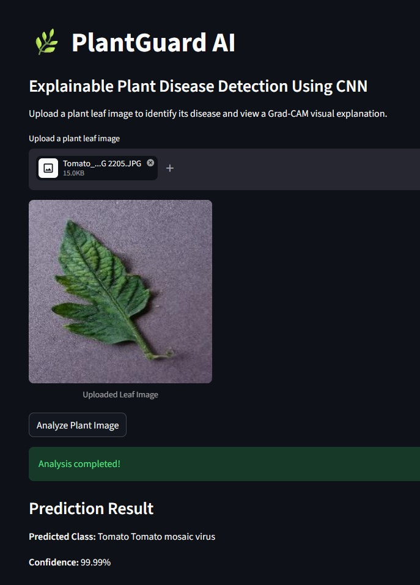
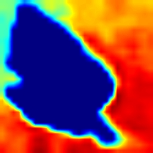

# 🌿 PlantGuard AI
## Explainable Plant Disease Detection Using Convolutional Neural Networks (CNNs)

### 1. Project Overview

PlantGuard AI is a Deep Learning-based application that identifies plant leaf diseases using Convolutional Neural Networks (CNNs).

The system classifies uploaded leaf images into 10 different disease categories and provides visual explanations using Grad-CAM (Gradient-weighted Class Activation Mapping).

The project combines CNN-based image classification with Explainable AI to make model predictions easier to understand.

### 2. Objectives

- Develop a CNN model for plant disease classification.
- Identify diseases from plant leaf images.
- Train and evaluate the CNN model using a labelled dataset.
- Apply Grad-CAM to visualize important image regions influencing predictions.
- Develop a user-friendly application using Streamlit.

### 3. Technologies Used

- Python
- TensorFlow and Keras
- NumPy
- Matplotlib
- Scikit-learn
- Streamlit
- PIL (Pillow)
- Google Colab
- Kaggle Dataset

### 4. Dataset Description

**Dataset:** PlantVillage Dataset

The project uses 10 selected classes covering healthy and diseased pepper, potato and tomato leaves.

The dataset is divided into:

- Training: 70%
- Validation: 15%
- Testing: 15%

Images are resized to 128 × 128 pixels and normalized before being supplied to the CNN model.

### 5. CNN Model Architecture

The proposed CNN architecture consists of:

1. Input Layer – 128 × 128 RGB images.
2. Data Augmentation – Random horizontal flipping and rotation.
3. First Convolution Block – 32 filters with ReLU activation.
4. Second Convolution Block – 64 filters with ReLU activation.
5. Third Convolution Block – 128 filters with ReLU activation.
6. MaxPooling Layers – Reduce feature-map dimensions.
7. Flatten Layer – Converts feature maps into a vector.
8. Dense Layer – 128 neurons with ReLU activation.
9. Dropout Layer – Reduces overfitting.
10. Output Layer – Softmax activation for 10 disease classes.

### 6. Model Training

The CNN model is trained using:

- Optimizer: Adam
- Loss Function: Categorical Crossentropy
- Evaluation Metric: Accuracy
- Maximum Epochs: 20
- Batch Size: 32
- Image Size: 128 × 128

EarlyStopping, ReduceLROnPlateau and ModelCheckpoint callbacks are used during training.

Class weights are also applied to handle class imbalance.

### 7. Model Evaluation

The trained model is evaluated using:

- Accuracy
- Precision
- Recall
- F1-score
- Classification Report
- Confusion Matrix

Training and validation accuracy and loss graphs are also generated to understand model performance.

### 8. Explainable AI Using Grad-CAM

Grad-CAM is used to explain the CNN model's predictions.

It generates a heatmap highlighting image regions that influence the predicted disease class.

The application displays:
- Grad-CAM Heatmap
- Grad-CAM Overlay
- Predicted Disease Class
- Prediction Confidence

### 9. Streamlit Application

The PlantGuard AI application provides the following features:

- Upload plant leaf images.
- Predict plant disease classes.
- Display prediction confidence.
- Show class probabilities.
- Generate Grad-CAM heatmaps.
- Display visual explanations.

### 10. Project Structure

```text
EDLproject/
│
├── app.py
├── EDL_PROJECT.ipynb
├── plant_disease_model.keras
├── class_names.json
├── requirements.txt
├── README.md
│
└── screenshots/
```

### 11. Installation and Execution

**Step 1: Clone the repository**

```bash
git clone YOUR_GITHUB_REPOSITORY_URL
```

**Step 2: Navigate to the project folder**

```bash
cd EDLproject
```

**Step 3: Install dependencies**

```bash
py -3.11 -m pip install -r requirements.txt
```

**Step 4: Run the Streamlit application**

```bash
py -3.11 -m streamlit run app.py
```

**Step 5: Upload a plant leaf image**

Upload an image and click the Analyze Plant Image button to view the prediction and Grad-CAM explanation.

### 12. Results

The project generates disease classification predictions, class probabilities, evaluation reports and Grad-CAM visual explanations.

The trained CNN model achieved approximately 95.64% test accuracy in the recorded notebook evaluation.

### 13. Conclusion

PlantGuard AI demonstrates the application of Deep Learning for plant disease classification using CNNs.

Grad-CAM provides visual explanations of model predictions, improving the interpretability of the classification process.

The project combines CNN-based classification, model evaluation, Explainable AI and a Streamlit interface into a single application.

### 14. Future Enhancements

- Extend the dataset with additional plant species and disease categories.
- Improve classification performance using larger datasets.
- Explore more advanced CNN architectures.
- Enhance the Grad-CAM explanations.
- Deploy the application for wider accessibility.

---

**Project Domain:** Essentials of Deep Learning (EDL)

**Project Title:** Explainable Plant Disease Detection Using Convolutional Neural Networks (CNNs)

## 9. Project Screenshots

### 1. PlantGuard AI Application


### 2. Disease Prediction Result


### 3. Class Probabilities


### 4. CNN Model Accuracy


### 5. CNN Model Loss


### 6. Confusion Matrix


### 7. Grad-CAM Heatmap


### 8. Grad-CAM Overlay

